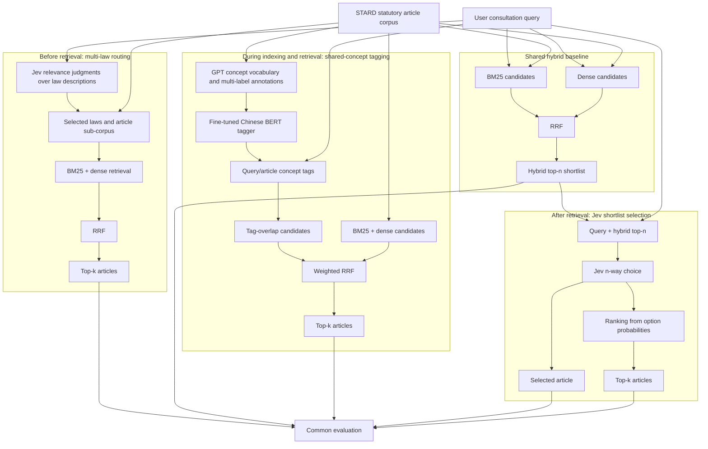

# Experimental pipeline

The three proposed methods are parallel interventions at different points of a shared legal retrieval pipeline. They should be compared independently rather than applied sequentially.

## Experimental ceilings

- **Routing retention** measures whether relevant articles survive the pre-retrieval routing stage.
- **Shortlist Recall@n** is the upper bound for both Jev shortlist selection and a conventional cross-encoder reranker.
- Concept-tag quality affects both candidate coverage and ranking because tag overlap participates in candidate generation and weighted fusion.

## Recommended implementation order

1. Reproduce BM25, dense, and RRF baselines.
2. Freeze shared data splits and evaluation code.
3. Add each intervention as an independent experiment.
4. Tune prompts, thresholds, routing breadth, fusion weights, and shortlist size only on validation data.
5. Run final evaluation once on the reserved development split.

